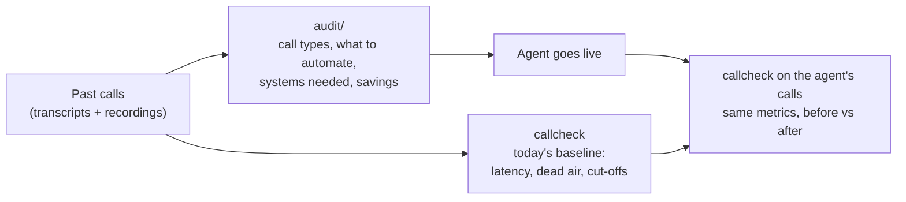

# callcheck

Tools for the first weeks of a voice AI deployment.

When a customer onboards, they usually have a pile of past calls handled by their human team. This repo turns that pile into four answers:

1. What callers want: the call types and how often each comes up.
2. What to automate first: which call types an agent can finish on its own, and which back-office systems it needs to do that.
3. What it saves: agent hours freed per month, as a range, with every assumption printed.
4. How callers' experience looks today: response times, dead air and how often callers get talked over.

After go-live, the same call grader runs on the agent's own calls, so the improvement is measured against that baseline.



Both parts were scored on labelled public data held out from tuning. Two held-out sets were scored more than once, and the sections below say where. Each number names the file in `results/` or `audit/` it comes from.

| Question | Tool | Tested on | Result |
|---|---|---|---|
| Which systems will the agent need? | `audit/run.py` | 300 held-out support conversations (ABCD) | precision 75%, recall 87% |
| How fast does the call center answer today? | `callcheck` | 40 held-out real phone calls, 131 min (SpokenWOZ) | 90% of 731 turns within 0.21 s of the human-marked time, after removing a constant annotation offset |
| How often are callers left waiting over 1.5 s? | `callcheck` | same 40 calls | precision 85%, recall 78% |
| How often are callers talked over? | `callcheck` | same 40 calls | precision 57%, recall 39% (first version 13% and 13%) |

<picture>
  <source media="(prefers-color-scheme: dark)" srcset="docs/cutoff-dark.png">
  
</picture>

## 1. Audit: what callers want and what to automate

`audit/run.py` reads each transcript with an LLM (DeepSeek v4.1 Flash through Vercel AI Gateway) and records three things: the reason for the call, whether an agent could resolve it end to end ("full", "partial" or "no"), and which systems it would need. A second pass groups the reasons into at most 12 call types. The report then gives each type's share, its automation split, the systems it needs, and a savings range. The per-conversation pass for the 300-conversation run below cost $0.59.

### How it was tested

ABCD (ASAPP, MIT licence) is a set of human customer-service conversations. Each one is labelled with what the customer wanted and every system action the human agent took. The model sees only the spoken lines, as a real transcript would show them, and is scored against the hidden labels. The action labels map to eight systems: account lookup, identity check, account changes, orders, refunds, membership and billing, FAQ, and handoff to a human. Prompts were adjusted on 40 dev conversations. The numbers below come from 300 test conversations that were not used for tuning. This test set was run three times (see Limits). The full output is `audit/SAMPLE_REPORT.md`.

| Check | Result |
|---|---|
| Systems the agent would need | precision 75%, recall 87% |
| Call types found vs the 10 true top-level reasons | 12 types, purity 72%, NMI 0.67 |
| Conversations with no usable answer after three tries | 0 of 300 |

ABCD has no automation label, but it records when the human agent escalated to another team. Those calls should rarely be judged fully automatable:

| Calls | n | full | partial | no |
|---|---|---|---|---|
| human agent escalated | 22 | 5% | 91% | 5% |
| all other calls | 278 | 97% | 1% | 1% |

What the report shows for each call type (first rows of `audit/SAMPLE_REPORT.md`):

| Call type | Share | Fully automatable | Systems needed |
|---|---|---|---|
| Subscription & Membership | 18% | 89% | membership_billing, account_lookup, identity_verification |
| Returns & Refunds | 13% | 92% | account_lookup, identity_verification, order_system |
| Order Changes & Status | 12% | 97% | identity_verification, order_system, account_lookup |
| Website, Search & Cart Issues | 10% | 67% | knowledge_base, human_handoff, order_system |
| ... 8 more types | | | |

### Limits

- It is too optimistic about automation. It marks 91% of all calls fully automatable. It separates escalated calls well, but almost never says "no", and ABCD has no label to check the 97% of ordinary calls it calls "full". Treat the automation split as a first pass for a person to review with the customer.
- It lists a system when unsure. That is the safer mistake when you scope integrations, but it lowers precision.
- It was tested on transcripts, not end to end from audio. A real onboarding adds a speech-to-text step first.
- The savings range depends entirely on four inputs: calls per month, handle time, agent cost per hour and AI cost per minute. They are command-line flags, and the report prints them next to the result.
- The test set was run three times. The first two runs used an earlier prompt: Sonnet 5.5 scored systems precision 71% and recall 89%, and DeepSeek scored 73% and 82%. Neither run marked a single call "not automatable", even complaints and transfers, so I changed the prompt on dev only, to judge automation from what happened in the call, and ran DeepSeek once more on test. The numbers above are from that third run. The earlier reports are in `audit/earlier_runs/`.

## 2. callcheck: how callers' experience looks today

`callcheck` takes a two-channel recording (caller on one channel, agent on the other) and reports every agent response latency plus these events:

- slow_response: the agent took more than 1.5 s to answer
- dead_air: more than 3 s
- cutoff: the agent started talking while the caller was still going
- false_barge_in: a cough or bump on the line made the agent stop mid-sentence
- wrong_readback: the agent read back a different number than the caller said (needs speech-to-text)

```
pip install -e . && callcheck call.wav --html report.html
```

Needs ffmpeg on the PATH. `--json` writes the raw results, and `--html` writes a one-page report with a timeline of each call. The Silero VAD model (MIT) downloads once on first run and is checked against a pinned SHA-256.

### How it works

Silero VAD runs on each channel, with an energy detector as a fallback for voices Silero under-detects. Caller pieces are joined into turns. Latency is the time from the end of the caller's turn to the start of the agent's.

A cut-off is one of two things:

- talk-over: the agent starts while caller speech is running and the caller keeps going for at least 0.5 s more;
- pause jump: the agent starts within 1 s of caller speech, and the caller resumes with at least 0.6 s of speech within 1.5 s.

A false barge-in is a short non-speech sound on the caller line followed by the agent going quiet within 1 s. Audio alone cannot tell whether the agent was about to finish anyway. The readback check runs faster-whisper on both channels and compares digit strings. All thresholds are in `callcheck/analyze.py:Config`, and `tests/test_detectors.py` pins the detector rules on hand-built cases.

### Real phone calls (human call center)

SpokenWOZ is a set of real two-party customer-service phone calls: 8 kHz stereo, one speaker per channel, utterance times marked by annotators. Both sides are human, so this is the "today" case exactly: a human call center before any agent goes live.

The annotators pad every utterance by about a third of a second on each side. The code removes 0.34 s from each start and 0.35 s from each end, measured first on 1090 turns; a later remeasure over 1131 turns gives medians of 0.33 s and 0.35 s (`results/real_phone_annotation_pad.txt`, from `realdata/telephone/measure_pad.py`). Without the correction, every latency looks 0.6 s too short, and the raw scores are in the same file as the main ones.

The analyzer was tuned on 32 calls (`results/real_phone_dev.txt`) and scored on 40 other calls, 131 minutes in all (`results/real_phone_holdout.txt`). 22 of the 40 were picked because they have many overlaps, so the set has enough cut-offs to score. The other 18 are random.

| Check | Result |
|---|---|
| Response latency, 731 turns | median error -0.08 s, 90% within 0.21 s, 98% within 0.5 s |
| Gaps over 1.5 s | precision 85%, recall 78% |
| Gaps over 3 s | precision 64%, recall 82% |
| Cut-off, 61 true cases (short "mm-hm" replies excluded) | precision 57%, recall 39% |
| Cut-off, 95% interval (bootstrap over calls) | precision 41% to 74%, recall 28% to 53% |

Cut-off recall fell from 75% on the 32 tuning calls to 39% on the held-out calls. The tuning set had only 12 true cut-offs, so the dev number was too small to trust. Most misses are talk-overs where the caller never pauses. The held-out calls were scored twice: once with the first cut-off detector, which scored 13% and 13% (`results/real_phone_holdout_first_version.txt`), and once after the rewrite. The first version counted line clicks as the caller resuming and missed every case where the caller never paused. I had seen the first held-out score before the rewrite, so 57% and 39% is not a clean first look.

### More results

Real meetings (AMI), synthetic calls with planted faults, the same calls with noise, echo and codecs, and a side study on endpointing (can audio alone tell when the caller is done?) are in [docs/RESULTS.md](docs/RESULTS.md). Short version: on clean synthetic calls every fault is found; noise and echo still hurt, mostly cut-off precision; and a plain 0.8 s silence timeout did as well as two trained endpointing models.

## Where it breaks

- Speech-like noise. A threshold set from each channel's noise floor fixed most steady noise (slow-reply recall on the noisy set went from 62% to 95%), but a TV in the background still reads as speech and creates false cut-offs (see docs/RESULTS.md).
- Echo and bleed. If one side's voice leaks into the other channel, callcheck sees phantom turns.
- Backchannels. A caller "mm-hm" is not a turn, but there is no class for it yet, so it can reset the latency timer.
- Talk-over recall. It still misses most interruptions where the caller never pauses.
- Real laughs and coughs. It finds planted coughs, but on AMI it flagged 0 of 25 real laughs or coughs that stopped the other speaker.
- Mono recordings are refused, because splitting a mono mix by speaker loses the overlaps that matter most.

## What I would do next

1. Echo: the agent's own audio is known, so cancel it from the caller channel before detection.
2. A backchannel class, so "mm-hm" stops resetting latency and stops counting as a cut-off.
3. Run the audit end to end from audio, with speech-to-text in front, and measure how much transcript errors cost.
4. Have a person review the "full" automation calls with a customer, and use their corrections to fix the prompt.

## Repo layout

`callcheck/` is the call grader, `audit/` the transcript audit, `synth/` the synthetic call generator and noise hardening, `realdata/` the real-call pipelines, `research/endpointing/` the side study, `results/` every score the README cites, `tools/` single-call debugging helpers, and `tests/` the unit tests that run in CI.

Synthetic data sets: `data/synthetic` and `data/heldout` were used while building; `data/final` (seed 2026) was generated once at the end for the final score; `data/human` swaps in LibriSpeech caller voices. None of the audio is committed.

## Reproduce

```
uv run --python 3.12 --with numpy python synth/generate.py --calls 60 --seed 2026 --out data/final
uv run --python 3.12 --with numpy python synth/verify.py data/final
uv run --python 3.12 --with numpy --with onnxruntime python score.py data/final phone
uv run --python 3.12 --with numpy --with onnxruntime --with faster-whisper python score_entities.py data/final phone
mkdir -p data/.corpora/spokenwoz_text data/.corpora/spokenwoz_test
curl -L -o data/.corpora/spokenwoz_text/data.json https://huggingface.co/datasets/ssz1111/SpokenWOZ-Test-Text-Fixed/resolve/main/data.json
curl -L -o data/.corpora/spokenwoz_test/audio_5700_test.zip https://huggingface.co/datasets/ssz1111/SpokenWOZ-Test-Audio-Fixed/resolve/main/audio_5700_test.zip
uv run --python 3.12 --with numpy python realdata/telephone/build_real_tel.py           # 32 tuning calls
uv run --python 3.12 --with numpy python realdata/telephone/build_real_tel.py holdout   # 40 held-out calls
uv run --python 3.12 --with numpy --with onnxruntime python realdata/telephone/score_real.py holdout
sh realdata/ami/fetch.sh                                   # ~2.2 GB of AMI audio
uv run --python 3.12 --with numpy python realdata/ami/build_pairs.py
uv run --python 3.12 --with numpy --with onnxruntime python realdata/ami/score_ami.py
uv run --python 3.12 --with numpy python synth/harden.py data/final data/hard --seed 1
uv run --python 3.12 --with numpy --with onnxruntime python score.py data/hard wideband
AI_GATEWAY_API_KEY=... python audit/run.py --split test --n 300   # needs data/.corpora/abcd/abcd_v1.1.json.gz
uv run --python 3.12 --with matplotlib python docs/charts.py
```

`synth/verify.py` checks every synthetic label against the audio with a plain energy detector, independent of callcheck. Breaking a label on purpose makes it fail.

## Data and licences

Audio is not in the repo. The scripts download or generate it.

- Synthetic calls: macOS `say` voices, generated by `synth/generate.py`.
- Human caller voices: LibriSpeech (CC BY 4.0).
- SpokenWOZ (CC BY-NC 4.0): used for evaluation only. Audio, per-call labels and transcript text stay local; only aggregate scores are committed.
- AMI Meeting Corpus (CC BY 4.0), University of Edinburgh.
- ABCD (MIT), ASAPP Research. Download `abcd_v1.1.json.gz` from github.com/asappresearch/abcd into `data/.corpora/abcd/`.
- Silero VAD (MIT), downloaded on first run.

Code: MIT.
