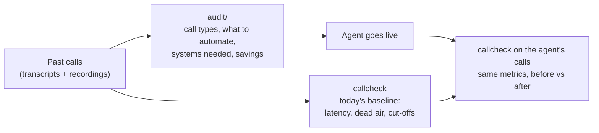
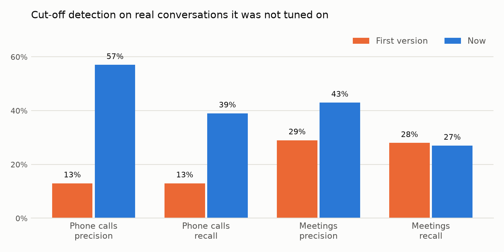
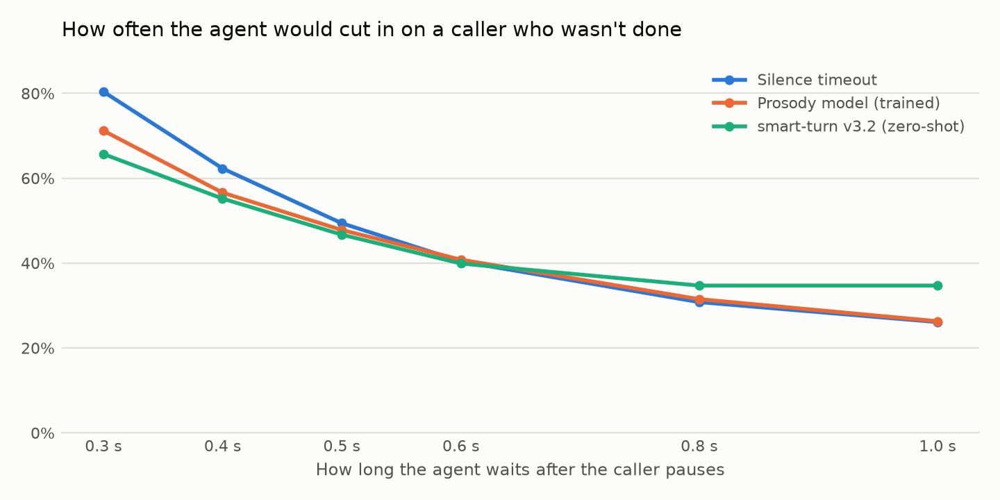

# callcheck

Tools for the first weeks of a voice AI deployment.

When a customer onboards, they usually have a pile of past calls handled by their human team. This repo turns that pile into four answers:

1. What callers want: the call types and how often each comes up.
2. What to automate first: which call types an agent can finish on its own, and which back-office systems it needs to do that.
3. What it saves: agent hours freed per month, as a range, with every assumption printed.
4. How callers' experience looks today: response times, dead air and how often callers get talked over.

After go-live, the same call grader runs on the agent's own calls. The improvement is then a measured before and after, not a claim.



Both parts were tested against labelled public data the code never saw while it was being tuned. Each number below names the file in `results/` or `audit/` it comes from.

| Question | Tool | Tested on | Result |
|---|---|---|---|
| Which systems will the agent need? | `audit/run.py` | 300 held-out support conversations (ABCD) | precision AUDIT_P, recall AUDIT_R |
| How fast does the call center answer today? | `callcheck` | 40 held-out real phone calls, 131 min (SpokenWOZ) | 90% of 731 turns within 0.21 s of the human-marked time |
| How often are callers left waiting over 1.5 s? | `callcheck` | same 40 calls | precision 85%, recall 78% |
| How often are callers talked over? | `callcheck` | same 40 calls | precision 57%, recall 39% (first version 13% and 13%) |

<picture>
  <source media="(prefers-color-scheme: dark)" srcset="docs/cutoff-dark.png">
  
</picture>

## 1. Audit: what callers want and what to automate

`audit/run.py` reads each transcript with an LLM (DeepSeek v4.1 Flash through Vercel AI Gateway) and records three things: the reason for the call, whether an agent could resolve it end to end ("full", "partial" or "no"), and which systems it would need. A second pass groups the reasons into at most 12 call types. The report then gives each type's share, its automation split, the systems it needs, and a savings range. The run below cost AUDIT_COST.

### How it was tested

ABCD (ASAPP, MIT licence) is a set of human customer-service conversations. Each one is labelled with what the customer wanted and every system action the human agent took. The model sees only the spoken lines, as a real transcript would show them, and is scored against the hidden labels. The action labels map to seven systems: account lookup, identity check, orders, refunds, membership and billing, FAQ, and handoff to a human. Prompts were adjusted on 40 dev conversations. The numbers below come from one run on 300 test conversations that were not used for tuning. The full output is `audit/SAMPLE_REPORT.md`.

| Check | Result |
|---|---|
| Systems the agent would need | precision AUDIT_P, recall AUDIT_R |
| Call types found vs the 10 true top-level reasons | AUDIT_TYPES |
| Conversations with no usable answer after three tries | AUDIT_UNKNOWN |

AUDIT_CALIBRATION

AUDIT_SAMPLE_TABLE

### Limits

- It is too optimistic about automation. AUDIT_OPTIMISM Treat the automation split as a first pass for a person to review with the customer, not as a commitment.
- It lists a system when unsure. That is the safer mistake when you scope integrations, but it lowers precision.
- It was tested on transcripts, not end to end from audio. A real onboarding adds a speech-to-text step first.
- The savings range depends entirely on four inputs: calls per month, handle time, agent cost per hour and AI cost per minute. They are command-line flags, and the report prints them next to the result.
- The first DeepSeek test run used an earlier prompt. It scored systems precision 73% and recall 82% and marked 88% of calls fully automatable. The prompt was then changed on dev only, to judge automation from what happened in the call, and rerun once on test. The numbers above are from that rerun.

## 2. callcheck: how callers' experience looks today

`callcheck` takes a two-channel recording (caller on one channel, agent on the other) and reports every agent response latency plus these events:

- slow_response: the agent took more than 1.5 s to answer
- dead_air: more than 3 s
- cutoff: the agent started talking while the caller was still going
- false_barge_in: a cough or bump on the line made the agent stop mid-sentence
- wrong_readback: the agent read back a different number than the caller said (needs speech-to-text)

```
pip install -e . && callcheck call.wav
```

The Silero VAD model (MIT) downloads once on first run and is checked against a pinned SHA-256.

### How it works

Silero VAD runs on each channel, with an energy detector as a fallback for voices Silero under-detects. Caller pieces are joined into turns. Latency is the time from the end of the caller's turn to the start of the agent's.

A cut-off is one of two things:

- talk-over: the agent starts while caller speech is running and the caller keeps going for at least 0.5 s more;
- pause jump: the agent starts within 1 s of caller speech, and the caller resumes with at least 0.6 s of speech within 1.5 s.

A false barge-in is a short non-speech sound on the caller line followed by the agent going quiet within 1 s. Audio alone cannot tell whether the agent was about to finish anyway. The readback check runs faster-whisper on both channels and compares digit strings. All thresholds are in `callcheck/analyze.py:Config`, and `tests/test_detectors.py` pins the detector rules on hand-built cases.

### Real phone calls (human call center)

SpokenWOZ is a set of real two-party customer-service phone calls: 8 kHz stereo, one speaker per channel, utterance times marked by annotators. Both sides are human, so this is the "today" case exactly: a human call center before any agent goes live.

The annotators pad every utterance by about 0.33 s at the start and 0.35 s at the end (medians over about 1130 turns, `results/real_phone_annotation_pad.txt`, from `realdata/telephone/measure_pad.py`). That constant is removed before scoring. Without the correction, every latency looks 0.6 s too short, and the raw scores are in the same file as the main ones.

The analyzer was tuned on 32 calls (`results/real_phone_dev.txt`) and scored once on 40 other calls, 131 minutes in all (`results/real_phone_holdout.txt`). 22 of the 40 were picked because they have many overlaps, so the set has enough cut-offs to score. The other 18 are random.

| Check | Result |
|---|---|
| Response latency, 731 turns | median error -0.08 s, 90% within 0.21 s, 98% within 0.5 s |
| Gaps over 1.5 s | precision 85%, recall 78% |
| Gaps over 3 s | precision 64%, recall 82% |
| Cut-off, 61 true cases | precision 57%, recall 39% |
| Cut-off, 95% interval (bootstrap over calls) | precision 41% to 74%, recall 28% to 53% |

Cut-off recall fell from 75% on the 32 tuning calls to 39% on the held-out calls. The tuning set had only 12 true cut-offs, so the dev number was too small to trust. Most misses are talk-overs where the caller never pauses. The first cut-off detector (`results/real_phone_holdout_first_version.txt`) scored 13% and 13%: it counted line clicks as the caller resuming, and it missed every case where the caller never paused.

### Real meetings

The AMI meeting corpus (CC BY 4.0) gives 29 four-minute windows of two people on individual headset mics. Meetings are harder than phone calls: many short "yeah" and "mm-hm" replies, laughter, and voice bleed between mics. Latency is within 0.5 s on 78% of matched turns. Cut-off precision is 43% and recall 27%, up from 29% and 28% for the first version (`results/ami.txt`, `results/ami_first_version.txt`).

### Synthetic calls with planted faults

60 synthetic calls with exact ground truth (seed 2026, generated once and not used for tuning). Every fault type is found with no false alarms on both the wideband and the 8 kHz phone copy: slow 21, dead air 16, cut-off 17, false barge-in 22. Median latency error is 52 ms (`results/synthetic_final_*.txt`). Readback finds 15 of 15 wrong numbers on phone audio, and 13 of 15 with 1 false alarm on wideband (`results/synthetic_final_readback.txt`). The same check with real human caller voices from LibriSpeech also finds every fault (`results/synthetic_human_callers_*.txt`). Synthetic calls are clean, so treat this as an upper bound.

### The same calls with noise, echo and codecs

`synth/harden.py` adds background noise (traffic, TV, fan, car at 5 to 20 dB SNR), echo of the agent into the caller line, quiet callers, clipping, Opus at 8 to 12 kbps and packet loss to the 60 synthetic calls. Timing does not change, so the same ground truth applies.

| 60 calls | Wideband recall / precision | Phone recall / precision |
|---|---|---|
| slow_response | 62% / 93% | 76% / 100% |
| dead_air | 62% / 100% | 94% / 100% |
| cutoff | 76% / 8% | 76% / 14% |
| false_barge_in | 32% / 100% | 59% / 93% |

Sources: `results/hard_wideband.txt`, `results/hard_phone.txt`. The per-condition split is in `results/hard_by_condition_wideband.txt`. Each call has several conditions at once. Calls with echo or noise under 10 dB SNR score worst: on echo calls, cut-off recall is 20% and false barge-in recall 0%. The energy fallback uses a fixed loudness threshold, so steady noise reads as caller speech and creates false cut-offs. Echo puts the agent's voice on the caller channel.

## Side study: can audio alone tell when the caller is done?

The same real calls give a clean test of endpointing, the decision a voice agent makes at every caller pause. On 99 held-out SpokenWOZ calls (2328 caller pauses), I compared a plain silence timeout with a gradient-boosted model on prosody features and with the open smart-turn v3.2 model run zero-shot.

<picture>
  <source media="(prefers-color-scheme: dark)" srcset="docs/endpointing-dark.png">
  
</picture>

The models only help when the agent answers very fast. At the waits a production agent would use, the plain timeout does as well. Most of what the model learned was pause length and how long this caller usually pauses. Pitch and energy added little. Human operators in these calls answer a median 1.0 s after the caller stops. Details, confidence intervals and limits are in `research/endpointing/RESULTS.md`. The likely next step is text: what the caller said, not how it sounded.

## Where it breaks

- Background noise. Steady noise defeats the fixed loudness threshold (table above). Fix: set the threshold relative to each channel's own noise floor.
- Echo and bleed. If one side's voice leaks into the other channel, callcheck sees phantom turns.
- Backchannels. A caller "mm-hm" is not a turn, but there is no class for it yet, so it can reset the latency timer.
- Talk-over recall. It still misses most interruptions where the caller never pauses.
- Real laughs and coughs. It finds planted coughs, but on AMI it flagged 0 of 25 real laughs or coughs that stopped the other speaker.
- Mono recordings are refused, because splitting a mono mix by speaker loses the overlaps that matter most.

## What I would do next

1. Noise-floor-relative energy threshold, then rerun the hard set.
2. A backchannel class, so "mm-hm" stops resetting latency and stops counting as a cut-off.
3. Run the audit end to end from audio, with speech-to-text in front, and measure how much transcript errors cost.
4. Have a person review the "full" automation calls with a customer, and use their corrections to fix the prompt.

## Repo layout

| Path | What it is |
|---|---|
| `callcheck/` | the call grader (`analyze.py` holds the detectors and thresholds) |
| `audit/` | the transcript audit and its sample report |
| `synth/` | synthetic call generator, label checker (`verify.py`) and noise/codec hardening |
| `score.py`, `score_entities.py`, `score_by_condition.py` | scoring on synthetic sets |
| `realdata/telephone/`, `realdata/ami/` | build and score the real-call sets |
| `research/endpointing/` | the endpointing study |
| `results/` | every score output the README cites |
| `tools/` | debugging helpers for single calls and clips |
| `tests/` | unit tests for the detectors and the CLI (run in CI) |

Synthetic data sets: `data/synthetic` and `data/heldout` were used while building; `data/final` (seed 2026) was generated once at the end for the final score; `data/human` swaps in LibriSpeech caller voices. None of the audio is committed.

## Reproduce

```
uv run --python 3.12 --with numpy python synth/generate.py --calls 60 --seed 2026 --out data/final
uv run --python 3.12 --with numpy python synth/verify.py data/final
uv run --python 3.12 --with numpy --with onnxruntime python score.py data/final phone
uv run --python 3.12 --with numpy --with onnxruntime --with faster-whisper python score_entities.py data/final phone
mkdir -p data/.corpora/spokenwoz_text data/.corpora/spokenwoz_test
curl -L -o data/.corpora/spokenwoz_text/data.json https://huggingface.co/datasets/ssz1111/SpokenWOZ-Test-Text-Fixed/resolve/main/data.json
curl -L -o data/.corpora/spokenwoz_test/audio_5700_test.zip https://huggingface.co/datasets/ssz1111/SpokenWOZ-Test-Audio-Fixed/resolve/main/audio_5700_test.zip
uv run --python 3.12 --with numpy python realdata/telephone/build_real_tel.py           # 32 tuning calls
uv run --python 3.12 --with numpy python realdata/telephone/build_real_tel.py holdout   # 40 held-out calls
uv run --python 3.12 --with numpy --with onnxruntime python realdata/telephone/score_real.py holdout
sh realdata/ami/fetch.sh                                   # ~2.2 GB of AMI audio
uv run --python 3.12 --with numpy python realdata/ami/build_pairs.py
uv run --python 3.12 --with numpy --with onnxruntime python realdata/ami/score_ami.py
uv run --python 3.12 --with numpy python synth/harden.py data/final data/hard --seed 1
uv run --python 3.12 --with numpy --with onnxruntime python score.py data/hard wideband
AI_GATEWAY_API_KEY=... python audit/run.py --split test --n 300   # needs data/.corpora/abcd/abcd_v1.1.json.gz
uv run --python 3.12 --with matplotlib python docs/charts.py
```

`synth/verify.py` checks every synthetic label against the audio with a plain energy detector, independent of callcheck. Breaking a label on purpose makes it fail.

## Data and licences

Audio is not in the repo. The scripts download or generate it.

- Synthetic calls: macOS `say` voices, generated by `synth/generate.py`.
- Human caller voices: LibriSpeech (CC BY 4.0).
- SpokenWOZ (CC BY-NC 4.0): used for evaluation only. Audio, per-call labels and transcript text stay local; only aggregate scores are committed.
- AMI Meeting Corpus (CC BY 4.0), University of Edinburgh.
- ABCD (MIT), ASAPP Research. Download `abcd_v1.1.json.gz` from github.com/asappresearch/abcd into `data/.corpora/abcd/`.
- Silero VAD (MIT), downloaded on first run.

Code: MIT.
