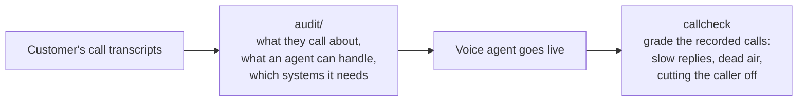

# callcheck

Two checks for moving a company's phone support onto a voice AI agent, built to be tested on real conversations rather than demos.



**Before:** read the transcripts and work out what is worth automating. **After:** grade the agent's real calls for the turn-taking failures callers notice. Both work on data from any platform.

What the testing found:

- On 300 labelled support conversations it never saw, the audit names the back-office systems an agent would need with **82% recall** (73% precision).
- On 131 minutes of real phone calls with human-marked timing, callcheck measures response latency **within 0.21 s on 90% of turns**. Its first cut-off detector was right 13% of the time; after a fix tuned on separate calls it is right 57% of the time and catches 39% of cut-offs.
- From audio alone, neither a trained model nor the open smart-turn model beat a plain 0.8 s silence timeout at deciding when a caller has finished.
- Background noise breaks the call grader. That is the next thing to fix, and the numbers are below.

<picture>
  <source media="(prefers-color-scheme: dark)" srcset="docs/cutoff-dark.png">
  
</picture>

## 1. Transcript audit

`audit/run.py` reads each conversation with an LLM (DeepSeek v4.1 Flash via Vercel AI Gateway, about 7 cents for 300 conversations) and returns the reason for the contact, whether an agent could resolve it end to end, and which systems it would need. A second pass groups the reasons into call types, and the report adds volumes and a savings estimate with every assumption printed.

**How it was tested.** ABCD (ASAPP, MIT licence) is a set of human customer-service conversations labelled with what the customer wanted and every system action the human agent took. The model sees only the spoken lines, as in a real transcript, and is scored against the hidden labels. Prompts were adjusted on 40 dev conversations. The numbers below come from one run on 300 *untouched* test conversations.

| Check | Result |
|---|---|
| Systems an agent would need (account lookup, identity check, orders, refunds, membership, FAQ, handoff) | precision 73%, recall 82% |
| Call types found vs the 10 true top-level reasons | 12 types, purity 67%, NMI 0.62 |
| Calls the human agent escalated: audit said "partial" | 12 of 22, vs 4% of the other calls |
| Conversations with no usable answer after three tries | 12 of 300 (4%) |

What a report looks like (`audit/SAMPLE_REPORT.md`):

| Call type | Share | Fully automatable | Systems needed |
|---|---|---|---|
| Subscriptions & membership | 17% | 88% | membership_billing, account_lookup, identity_verification |
| Returns & refunds | 13% | 78% | account_lookup, identity_verification, order_system |
| Shipping & delivery | 12% | 94% | identity_verification, order_system, account_lookup |
| ... 9 more types | | | |

**Limits.** It lists a system when unsure, which is the safer mistake when scoping integrations. It is too optimistic about automation: 10 of the 22 calls a human escalated were still marked fully automatable. Treat the automation split as a first pass for a person to review. The savings figure depends entirely on the assumptions (calls per month, handle time, agent cost, AI cost per minute), which are flags. Sonnet 5.5 scored precision 71% and recall 89% on the same 300 conversations at about 15 times the cost.

## 2. Call grading

`callcheck` takes a two-channel recording (caller on one channel, agent on the other) and reports every agent response latency plus these events:

- **slow_response**: the agent took more than 1.5 s to answer
- **dead_air**: more than 3 s
- **cutoff**: the agent started talking while the caller was still going
- **false_barge_in**: a cough or bump on the line made the agent stop mid-sentence
- **wrong_readback**: the agent read back a different phone number than the caller said (needs speech-to-text)

```
pip install -e . && callcheck call.wav
```

**How it works.** Silero VAD runs on each channel, with an energy detector as a fallback for voices Silero under-detects. Caller pieces are joined into turns, and latency is measured from the end of the caller's turn to the start of the agent's. A cut-off is either the agent starting while caller speech is still running, or the agent jumping into a short caller pause (under 1 s) after which the caller resumes within 1.5 s. A false barge-in is a short non-speech sound on the caller line followed by the agent going quiet within 1 s. The readback check runs faster-whisper on both channels and compares digit strings. All thresholds are in `callcheck/analyze.py:Config`.

### Real phone calls, human-marked timing

SpokenWOZ test set: real two-party customer-service phone calls, 8 kHz stereo, one speaker per channel, utterance times marked by annotators. The annotation pads every utterance by about 0.35 s on each side (measured against channel energy over 1090 turns), so that constant is removed before scoring. The analyzer was tuned on 32 calls and scored on 40 *untouched* calls (131 min).

| Check | Result |
|---|---|
| Response latency, 731 turns | median error -0.08 s, 90% within 0.21 s |
| Gaps over 1.5 s | precision 85%, recall 78% |
| Gaps over 3 s | precision 64%, recall 82% |
| Cut-off (agent talks over caller) | precision 57%, recall 39% (first version: 13%, 13%) |

The first cut-off detector counted line clicks as the caller resuming, and it missed every case where the caller never paused.

### Real meetings, word-level timing

AMI meeting corpus: 29 four-minute windows of two people talking on individual headset mics. These have many short "yeah" and "mm-hm" acknowledgements, laughter, and voice bleed between mics, so they are harder than phone calls. Latency is within 0.5 s on 78% of turns. Cut-off precision is 43% and recall 27%; on the 19 clips with little bleed they are 51% and 33%.

### Synthetic calls with planted faults

60 calls with exact ground truth, seed 2026, *untouched*. Every fault type is found with no false alarms on both the wideband and the 8 kHz phone copy (slow 21, dead air 16, cut-off 17, false barge-in 22). Readback: 15 of 15 on phone, 13 of 15 with 1 false alarm on wideband. Latency error is 51 ms median. Synthetic calls are clean, so this is an upper bound.

### Same calls with noise, echo and codecs added

`synth/harden.py` adds background noise (traffic, TV, fan, car at 5 to 20 dB SNR), echo of the agent into the caller line, quiet callers, clipping, Opus at 8 to 12 kbps and packet loss to the 60 synthetic calls. Timing is unchanged, so the same ground truth applies.

| Wideband, 60 calls | Recall | Precision |
|---|---|---|
| slow_response | 62% | 93% |
| dead_air | 62% | 100% |
| cutoff | 76% | 8% |
| false_barge_in | 32% | 100% |

Applied one at a time, codec, packet loss, quiet callers and clipping do no damage. Noise and echo do all of it. The energy fallback uses a fixed loudness threshold, so steady noise reads as one caller turn spanning the whole call. Echo puts the agent's voice on the caller channel.

## Side study: can audio alone tell when the caller is done?

The same real calls give a clean test of endpointing, the decision a voice agent makes at every caller pause. On 99 held-out SpokenWOZ calls (2328 caller pauses), I compared a plain silence timeout with a gradient-boosted model on prosody features and with the open smart-turn v3.2 model run zero-shot.

<picture>
  <source media="(prefers-color-scheme: dark)" srcset="docs/endpointing-dark.png">
  
</picture>

The models only help when the agent answers very fast. At the waits a production agent would use, the timeout is as good. Most of what the model learned was pause length and how long this caller usually pauses, and pitch and energy added little. Human operators in these calls answer a median 1.0 s after the caller stops. Details, confidence intervals and limits are in `research/endpointing/RESULTS.md`. The likely next step is text, meaning what the caller said rather than how it sounded.

## Where it breaks

- **Background noise.** Steady noise defeats the fixed loudness threshold (see the table above). Fix: a threshold set relative to each channel's own noise floor.
- **Echo and bleed.** If one side's voice leaks into the other channel, callcheck sees phantom turns.
- **Backchannels.** A caller "mm-hm" is not a turn, but there is no class for it yet, so it can reset the latency timer.
- **Talk-over recall.** It still misses most interruptions where the caller keeps talking and never pauses.
- **Real laughs and coughs.** It finds planted coughs, but on AMI it flagged 0 of 25 real laughs or coughs that stopped the other speaker.
- **Mono recordings** are refused, because splitting a mono mix by speaker loses the overlaps that matter most.

## Reproduce

```
uv run --python 3.12 --with numpy python synth/generate.py --calls 60 --seed 2026 --out data/final
uv run --python 3.12 --with numpy python synth/verify.py data/final
uv run --python 3.12 --with numpy --with onnxruntime python score.py data/final phone
uv run --python 3.12 --with numpy --with onnxruntime --with faster-whisper python score_entities.py data/final phone
mkdir -p data/.corpora/spokenwoz_text data/.corpora/spokenwoz_test
curl -L -o data/.corpora/spokenwoz_text/data.json https://huggingface.co/datasets/ssz1111/SpokenWOZ-Test-Text-Fixed/resolve/main/data.json
curl -L -o data/.corpora/spokenwoz_test/audio_5700_test.zip https://huggingface.co/datasets/ssz1111/SpokenWOZ-Test-Audio-Fixed/resolve/main/audio_5700_test.zip
uv run --python 3.12 --with numpy python realdata/telephone/build_real_tel.py           # 32 tuning calls
uv run --python 3.12 --with numpy python realdata/telephone/build_real_tel.py holdout   # 40 held-out calls
uv run --python 3.12 --with numpy --with onnxruntime python realdata/telephone/score_real.py holdout
sh realdata/ami/fetch.sh                                   # ~2.2 GB of AMI audio
uv run --python 3.12 --with numpy python realdata/ami/build_pairs.py
uv run --python 3.12 --with numpy --with onnxruntime python realdata/ami/score_ami.py
uv run --python 3.12 --with numpy python synth/harden.py data/final data/hard --seed 1
uv run --python 3.12 --with numpy --with onnxruntime python score.py data/hard wideband
AI_GATEWAY_API_KEY=... python audit/run.py --split test --n 300   # needs data/.corpora/abcd/abcd_v1.1.json.gz
uv run --python 3.12 --with matplotlib python docs/charts.py
```

`synth/verify.py` checks every synthetic label against the audio with a plain energy detector, independent of callcheck. Breaking a label on purpose makes it fail.

## Data and licences

Audio is not in the repo. The scripts download or generate it.

- Synthetic calls: macOS `say` voices, generated by `synth/generate.py`.
- Human caller voices: LibriSpeech (CC BY 4.0).
- SpokenWOZ (CC BY-NC 4.0): used for evaluation only; audio and derived labels stay local.
- AMI Meeting Corpus (CC BY 4.0), University of Edinburgh.
- ABCD (MIT), ASAPP Research; download `abcd_v1.1.json.gz` from github.com/asappresearch/abcd into `data/.corpora/abcd/`.
- Silero VAD (MIT), downloaded on first run.

Code: MIT.
